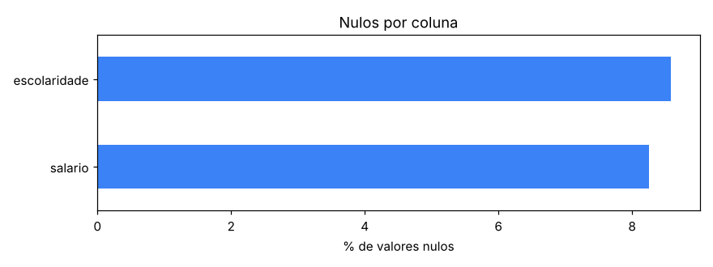
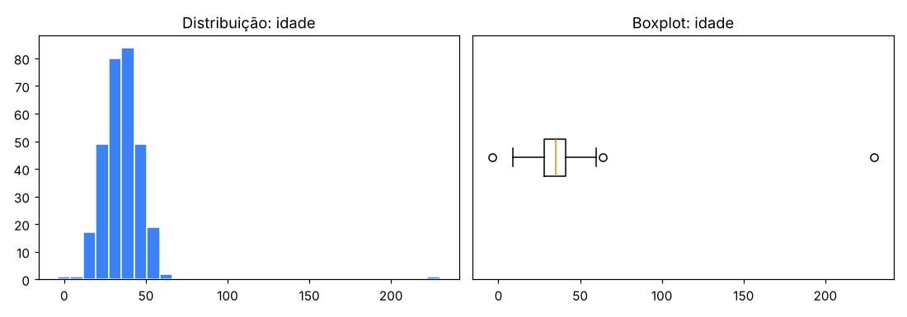
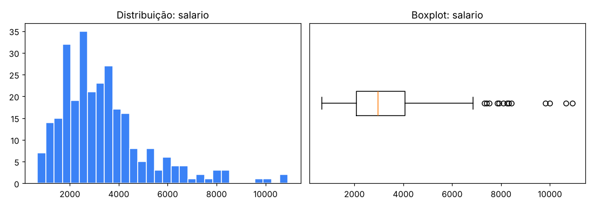
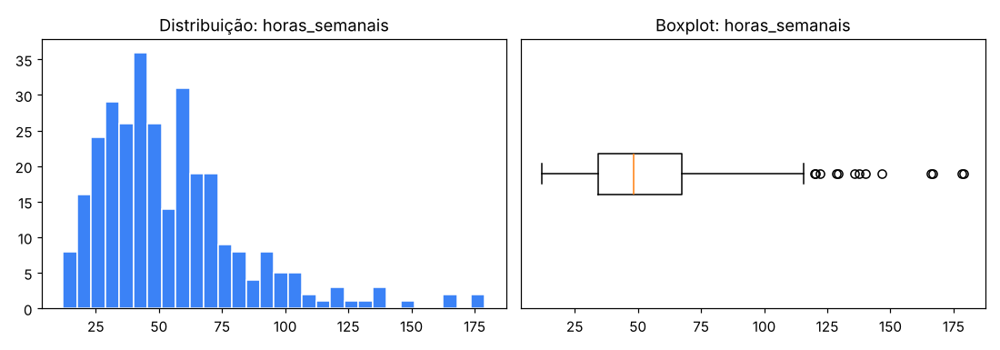
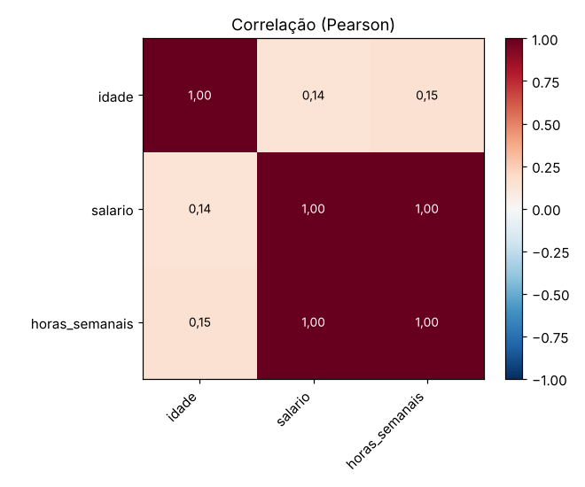

# Relatório de EDA: dados_teste.csv

## Visão geral

- Linhas: 303
- Colunas: 7
- Linhas duplicadas: 3 (0,99%)
- Células nulas: 51 (2,40%)

## Colunas

| Coluna | Tipo | Nulos (%) | Únicos |
|---|---|---|---|
| id | int64 | 0,00 | 300 |
| cidade | str | 0,00 | 9 |
| idade | float64 | 0,00 | 48 |
| salario | float64 | 8,25 | 275 |
| horas_semanais | float64 | 0,00 | 250 |
| escolaridade | str | 8,58 | 3 |
| pais | str | 0,00 | 1 |

## Colunas numéricas

| Coluna | Média | Mediana | Mín. | Máx. | Assimetria | Outliers (IQR) |
|---|---|---|---|---|---|---|
| idade | 35,46 | 35,00 | -4,00 | 230,00 | 6,96 | 3 |
| salario | 3.350,83 | 2.976,71 | 677,04 | 10.925,30 | 1,47 | 13 |
| horas_semanais | 54,66 | 48,30 | 12,10 | 179,10 | 1,50 | 13 |

## Colunas de texto ou categóricas

| Coluna | Mais frequentes | Grafias suspeitas* |
|---|---|---|
| cidade | Mossoró (87); Parnamirim (75); Caicó (70) | 5 |
| escolaridade | Médio (124); Superior (98); Pós (55) | 0 |
| pais | Brasil (303) | 0 |

*Valores que só diferem por maiúsculas/minúsculas ou espaços (ex.: "Natal" e "natal ").

## Alertas automáticos

- **id**: um valor diferente por linha. Parece um identificador e ficou fora das estatísticas e dos gráficos.
- **cidade**: 5 categorias com grafia diferente para o mesmo valor.
- **idade**: 3 outliers pela regra do IQR (fora de 8,50 a 60,50).
- **idade**: distribuição bem assimétrica (6,96).
- **salario**: 8,25% nulos. Defina como tratar.
- **salario**: 13 outliers pela regra do IQR (fora de -886,62 a 7.029,00).
- **salario**: distribuição bem assimétrica (1,47).
- **horas_semanais**: 13 outliers pela regra do IQR (fora de -15,67 a 117,33).
- **horas_semanais**: distribuição bem assimétrica (1,50).
- **escolaridade**: 8,58% nulos. Defina como tratar.
- **pais**: valor constante. Provavelmente pode ser descartada.
- **Duplicados**: 3 linhas repetidas por inteiro.

## Correlações fortes (|r| ≥ 0,7)

- salario × horas_semanais: 1,00

Lembrete: correlação não é causalidade.

## Gráficos

